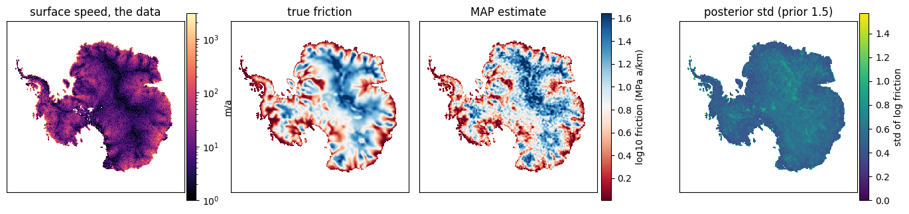
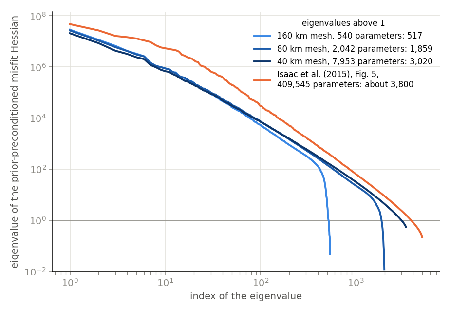

# The Antarctic ice sheet

The basal friction of the Antarctic ice sheet is inferred from the velocity of its
surface, with its uncertainty, and pushed through to a prediction of the ice it sends to
the ocean: the problem of T. Isaac, N. Petra, G. Stadler and O. Ghattas, *Scalable and
efficient algorithms for the propagation of uncertainty from data through inference to
prediction for large-scale problems, with application to flow of the Antarctic ice sheet*
(J. Comput. Phys. 296, 2015), with hIPPyMFEM on GPUs.

The ice is a viscous, incompressible, shear-thinning fluid (full Stokes with Glen's law);
the unknown is the log of the friction coefficient of a sliding law on its bed; the data
are the horizontal velocity of its surface; the predictions are the mass fluxes through
the margins that face the ocean.

What it shows about the library: a problem with two unknowns in two spaces (Taylor-Hood
velocity and pressure), which `PDEVariationalProblem` does not take, is written as one
residual density over six slots, and the library's kernels differentiate it into every
block the inverse problem needs, the Newton Jacobian of Glen's law included.  A class
glues the blocks and implements the library's `PDEProblem` interface; `Model`,
`ReducedSpaceNewtonCG`, `ReducedHessian`, `BiLaplacianPrior` and `GaussianLRPosterior`
then run unchanged.



*The synthetic problem at 20 km (3.46 million unknowns, 31 172 parameters, one GPU): the
surface speed observed, the friction that made it, the friction inferred, and what is left
of the prior's uncertainty (with the low rank; the sparse Hessian leaves less, see the
results).*

## The problem

| | the paper | here |
|---|---|---|
| flow | full Stokes, Glen's law n = 3, rate factor from Paterson-Budd | the same; the temperature of a column from Robin's solution |
| bed | no penetration, sliding with friction `exp(beta)` | the same, no penetration by a penalty |
| margins | sea pressure where the ice meets the ocean, no slip on land, no ice shelves | the same |
| mesh | an adapted forest of quadtrees over ALBMAP, extruded into columns of hexahedra, Q_k x Q_{k-2}^disc; its inversion, by its counts, on one layer of Q2 x Q0^disc elements | columns of hexahedra over the ALBMAP grid (5 km coarsened 1x to 32x), Taylor-Hood Q2 x Q1, 1 to 22 layers |
| friction | a field on the bed; by its counts biquadratic, the trace of the velocity's space | bilinear on the grid's cells, or biquadratic (`--friction-order 2`) |
| size | 3.8 million state unknowns, 409 545 parameters | 3.5 million and 31 172 at 20 km with four layers, 4.6 million and 484 908 at 10 km with one layer and the biquadratic friction, 16.7 million and 484 908 with five layers; the forward problem (and a gradient, its adjoint solve to 2e-5) to 1.09 billion, gradient and Hessian action to 104 million |
| data | InSAR surface velocity; the misfit an integral over the surface, noise 10 % of the speed | ITS_LIVE surface velocity, and the InSAR map where ITS_LIVE has none (south of 82.7 S); the same misfit; or the model's own velocity at a known friction |
| prior | `(-gamma Laplacian + delta)^-2`, gamma 10, delta 1e-5 | the same |
| MAP point | inexact Newton-CG | inexact Gauss-Newton-CG; without a factorization, Newton's method with a sparse Hessian (`--map-solver local`) |
| posterior | low rank of the misfit Hessian, 5000 products | the same, grown until its eigenvalues are below 1; or the misfit Hessian as a sparse matrix, from a few hundred to a thousand products (`--hessian local`) |
| predictions | mass flux into the ocean (all margins, East Antarctica, Totten Glacier), linearized | the same, and over posterior samples through the nonlinear model |

## How it is written

* `stokes.py`: the residual density of momentum and mass over the slots
  `(u, p, beta, B, v, q)`, the boundary densities of the bed and the margins, and
  `IceSheet`, which assembles the blocks with the library's `QuadratureKernel` and
  `BoundaryKernel`, solves the forward problem by Newton with a continuation in the
  strain-rate floor, and gives `hm.Model` the adjoint, incremental and parameter-derivative
  operators of the Gauss-Newton Hessian.  Also the two misfits (points, and the integral
  over the surface) and the linear solver for several ranks.
* `gpu_direct.py`: NVIDIA's cuDSS on the monolithic Jacobian, analysed once and
  refactorized in place.  The Jacobian is symmetric, so the adjoint and every incremental
  solve reuse its factorization, and a block of Hessian products is two solves with many
  right-hand sides.
* `matrixfree.py`: the Newton systems without their matrices, for meshes past the memory
  of any factorization.  A product with the Jacobian is one pass of the library's element
  kernels (a forward tangent through the residual), and FGMRES is preconditioned by what
  thin ice suggests: exact solves on every vertical line of nodes, the problem collapsed
  over the depth, and the Schur complement of the lines on patches of columns.  On one
  rank the collapsed problem is factorized on the card, and an inversion runs on this
  solver (`run.py --solver columns`).
* `lowrank.py`: the double pass of `doublePassG`, a block of columns at a time.
* `localhessian.py`: the misfit Hessian as a sparse matrix, from products with combs of
  unit vectors, and the posterior with it (solves, samples) through one sparse system;
  also the Newton step of a MAP solve that has no factorization to lean on.
* `antarctica.py`: ALBMAP and the surface velocity (ITS_LIVE, and MEaSUREs around the
  pole) onto a model grid, the margins, the column temperature, the meshes.
* `run.py`: the inverse problem in stages (data, verify, map, eig, post, qoi), each
  resuming what an earlier run saved.  `scale.py`: the forward problem, a gradient and a
  Hessian action at any size.  `figures.py`: the figures of a run.
* `laplace_check.py`, `laplace_check_local.py`: how Gaussian the posterior of a finished
  run is, with the low rank and with the sparse Hessian.

## Running it

```
python antarctica.py fetch            # ALBMAP, ITS_LIVE and MEaSUREs into data/ (570 MB)
python antarctica.py cache            # the model grids, data/grid_r*.npz
export HIPPYMFEM_DEVICE=gpu HIPPYMFEM_GPU_MEM_FRACTION=0.2

# the synthetic problem at 40 km (--res 8), then its figures; and at 20 km, the size of the results below
python run.py --res 8 --nz 3 --max-cols 8000 --qoi-samples 32 --out out/syn40
python figures.py out/syn40
python run.py --res 4 --nz 4 --block 300 --max-cols 30000 --qoi-samples 32 --out out/syn20
# its posterior with the sparse Hessian in the place of the low rank (144 products): a copy of the folder, or --stages data,map before
python run.py --res 4 --nz 4 --hessian local --reach 120 --stages data,map,eig,post --out out/syn20
# 10 km with one layer, from the 20 km MAP point: bilinear friction, and biquadratic (485 thousand parameters)
export HIPPYMFEM_GPU_MEM_FRACTION=0.45
python run.py --res 2 --nz 1 --init from:out/syn20 --rtol 1e-3 --hessian local --reach 100 --stages data,map,eig,post --out out/syn10
python run.py --res 2 --nz 1 --friction-order 2 --init from:out/syn20 --rtol 2e-3 --hessian local --reach 80 \
    --stages data,map,eig,post --out out/syn10q2
# 10 km with five layers (16.7 million state unknowns), without any matrix: the MAP point by Newton's method with
# the sparse Hessian of the one-layer run, the 1024 products with the combs of its own as eight jobs, the posterior
export HIPPYMFEM_GPU_MEM_FRACTION=0.3
FIVE="--res 2 --nz 5 --friction-order 2 --solver columns --map-solver local --local-from out/syn10q2 --init from:out/syn10q2
      --g-ref 660 --rtol 2e-3 --hessian local --reach 80 --out out/syn10q2z5"
python run.py $FIVE --krylov-rtol 1e-10 --forward-rtol 1e-10 --stages data,map
for k in 0 1 2 3 4 5 6 7; do python run.py $FIVE --krylov-rtol 1e-6 --local-share $k/8 --stages data,map,eig; done
python run.py $FIVE --krylov-rtol 1e-6 --local-share 0/8 --stages data,map,eig,post
# that path against the factorization: five layers at 40 km, both from the one-layer MAP point
python run.py --res 8 --nz 1 --friction-order 2 --hessian local --reach 120 --stages data,map,eig,post --out out/v40z1
FROM="--res 8 --nz 5 --friction-order 2 --init from:out/v40z1 --g-ref 129.1 --rtol 1e-5 --hessian local --reach 120
      --stages data,map,eig,post"
python run.py $FROM --solver columns --krylov-rtol 1e-10 --forward-rtol 1e-10 --map-solver local --local-from out/v40z1 \
    --out out/v40z5mf
python run.py $FROM --out out/v40z5

# the paper's problem with the observed velocities, at 160 km, 80 km and at 40 km from the 80 km MAP point
python run.py --res 32 --nz 3 --data observed --out out/obs160
python run.py --res 16 --nz 2 --data observed --out out/obs80
python run.py --res 8 --nz 3 --data observed --init from:out/obs80 --g-ref 650 --max-cols 9000 --out out/obs40
python figures.py out/obs160 out/obs80 out/obs40 --spectra spectra.png

# the forward problem, a gradient and a Hessian action at 10 km on 16 GPUs
mpirun -n 16 ../../tools/mpirun_pinned.sh python scale.py --res 2 --nz 4
# more levels, started from that solution
mpirun -n 16 ../../tools/mpirun_pinned.sh python scale.py --res 2 --nz 4 --no-derivatives --save-state out/s4
mpirun -n 16 ../../tools/mpirun_pinned.sh python scale.py --res 2 --nz 8 --start-from out/s4
# without any matrix: the same solve on one GPU, and a mesh refined once (5 km cells, 16 layers) from that solution
python scale.py --res 4 --nz 4 --solver columns --forcing --no-derivatives
mpirun -n 16 ../../tools/mpirun_pinned.sh python scale.py --res 2 --nz 8 --refine 1 --solver columns --forcing \
    --no-derivatives --start-from out/s4
```

`antarctica.py fetch` and `cache` need `netCDF4`, `rasterio` and `pyshp` to read the
datasets, and `fetch` a connection to the internet, which on a cluster is the login
node's.  The direct solver needs `cupy`, `nvmath-python` and `nvidia-cudss-cu12`, the
matrix-free one `cupy` (and cuDSS on one rank); `--solver scipy` runs the small meshes on
the host.  A 20 km inversion takes an 80 GB card; the products and the posterior of the
five-layer one at 10 km ran on such cards too, with half the card for JAX
(`HIPPYMFEM_GPU_MEM_FRACTION=0.52`).

Both solvers are written for NVIDIA cards: the direct one is cuDSS, and the matrix-free
one does its solves on the columns, its probing and its patches with CuPy.  On the cards
of another vendor the direct solver does not exist, and the matrix-free one needs a CuPy
built for them (for AMD cards, CuPy's ROCm build), which has not been tried.

## Results

**A test with a known answer** (`--data synthetic`).  The data are the model's own surface
velocities at a known friction, with the noise of the observed problem's misfit: 10 % of
the speed, independent per 80 km x 80 km of surface.  On one H200 (the products of the
last column on eight cards, a job each):

| | 20 km, 4 layers | 10 km, 1 layer | 10 km, 1 layer, biquadratic friction | 10 km, 5 layers, biquadratic friction |
|---|---:|---:|---:|---:|
| parameters | 31 172 | 122 839 | 484 908 | 484 908 |
| state unknowns | 3.46 million | 4.61 million | 4.61 million | 16.74 million |
| linear solver | cuDSS | cuDSS | cuDSS | none of the mesh's size (`--solver columns`) |
| MAP point: Gauss-Newton iterations, CG iterations | 23, 767 | 16, 578 | 11, 274 | 2 Newton steps with the third column's sparse Hessian |
| correlation of the MAP point with the truth | 0.955 | 0.954 | 0.957 | 0.955 |
| low rank: eigenpairs, Hessian products, time | 5750, 11 540, 39 min | 6350, 12 740, 109 min | stopped at 1270 eigenpairs after 2.5 h | |
| standard deviation of the log friction with it | 1.50 to 0.56 | 1.48 to 0.54 | | |
| sparse Hessian: reach, Hessian products, time | 120 km, 144, 21 s | 100 km, 400, 74 s | 80 km, 1024, 222 s | 80 km, 1024, 6.1 GPU-hours |
| its error on white vectors, on prior samples | 1.1 %, 1.9 % | 0.7 %, 2.2 % | 0.5 %, 2.8 % | 0.5 %, 3.3 % |
| standard deviation of the log friction with it | 1.50 to 0.49 | 1.48 to 0.45 | 1.48 to 0.43 | 1.48 to 0.45 |
| 1012 posterior draws with it | 84 s | 164 s | 284 s | 350 s |

The 20 km run starts from the prior mean and stops at a gradient reduction of 1e-5.  The
one-layer runs at 10 km start from its MAP point (`--init from:`), whose misfit is already
at the level of the noise, and stop where their gradients stop falling (5e-4 and 3e-4 of
the first, the cost constant to seven digits).  The third has a biquadratic friction on
its one layer of elements: the discretization of the paper's inversion as its
counts give it away (3 785 889 = 9 x 409 545 + 99 984: three levels of three velocity
components at every node of the friction, and one pressure per element), here on 119 561
columns where the paper has 99 984.  The standard deviations are root mean squares over
the nodes; the error of the sparse Hessian is measured against the Hessian's own products
with eight vectors it was not made from.  The last column is the third with five layers of
elements, on the solver that has no matrix (below).

**Low rank, or the matrix itself.**  The velocity is observed everywhere and answers to
the friction under it, so a column of the misfit Hessian is a positive bump around its
node: at 20 km it is 52 %, 15 %, 4.5 % and 1.5 % of its diagonal entry 20 to 40, 40 to
60, 60 to 80 and 80 to 100 km away, with 99 % of it within 130 km (within 92 km at
10 km), and its negative entries are 0.2 % of the positive ones.  Such a matrix has
thousands of eigenvalues above 1, more on every finer grid until the data's own
resolution is reached, and a slow tail (at 20 km 5227 above 1, and still 0.3 at the
8000th of 31 172).  A low rank pays for every one of them with two products, and the
randomized one is least accurate where the spectrum is flat: with 5770 columns it finds
4557 of the 5227, its last eigenvalue is 0.32 where the matrix has 0.78, and the
standard deviation it gives is 15 % too high.  On its own draws the low rank of the
40 km run (4100 eigenpairs) holds 52 % of the Gauss-Newton curvature
`1/2 delta^T H delta`; that test costs a few products and says when a low rank is not
enough.

`--hessian local` (`localhessian.py`) takes the entries of the matrix instead.  The sum of
the unit vectors of every `s`-th node in x and in y is a comb; where its teeth are further
apart than two reaches of a column, one product gives the columns of all of them, and
`s^2` combs cover every node: `(2 reach / node spacing)^2` products, whatever the number
of parameters and the rank.  The posterior precision is that sparse matrix plus the
prior's `A M^-1 A`, solved through the sparse system `[[H, A], [A, -M]]`: factorized by
cuDSS while it is small, and by conjugate gradients preconditioned with the same system
for the Hessian lumped onto its diagonal on the fine grids (29 to 32 iterations).  A
sample is one such solve with the prior's noise and one adjoint solve, and the pointwise
variances are mean squares of 1000 samples.  The number of products does grow as the
grid is refined under a fixed reach; the point spread function method of Alger,
Hartland, Petra and Ghattas (SIAM J. Sci. Comput. 2024), which interpolates columns
taken at scattered points, removes that.

How far to reach is a matter of a few percent.  At 20 km a reach of 80 km (64 products,
errors of 3.8 % and 5.3 %) gives the standard deviation of 120 km, 0.486.  At 10 km with
the biquadratic friction, 40 km (256 products, 2.6 % and 8.7 %) gives 0.41 where 80 km
gives 0.43.  A cut-off loses the tail of every row, 8 % of the sum of the rows at 40 km,
and that sum is known, since the responses of the combs add up to `H 1`.  Three ways of
keeping it were tried on the 256 products, and all do worse on samples of the prior, where
the cut-off is 8.9 % off: the tail on the diagonal (12 %), the rows scaled (10 %), and a
taper to zero at the reach with what it takes on the diagonal (22 %, and a standard
deviation of 0.37 for 0.49 at 20 km).  They are exact on a constant, but a sample of the
prior is not smooth across a column of this matrix: the row sums in the place of the
matrix are 27 % off on one.

A cut-off matrix need not be positive, and on a grid too coarse for its reach it is not:
at 160 km (2013 parameters, combs 480 km apart, errors of 11 % and 9 %) the sparse Hessian
plus the prior has 25 negative eigenvalues, and what its solves give has variances up to
60 times the prior's at 3 % of the nodes.  The run stops there: the factorization of the
sparse system reports its inertia, and the conjugate gradients stop at a negative
curvature.  A variance above the prior's, which data cannot cause, is reported as well; on
the 20 km and 10 km grids none is, beyond the noise of the 1000 draws.

**Five layers, without a matrix.**  With two layers the factors of the 10 km mesh no
longer fit an H200 next to the element kernels, and with five (16.7 million unknowns) they
would take some 300 GB.  `--solver columns` runs the inversion on `matrixfree.py` instead,
on one card: the forward solve at the true friction takes 530 s (31 Newton steps), an
adjoint solve 17 s and a Gauss-Newton Hessian product 21 s.  What the factorization gave
is replaced in three places:

* The MAP point is found by Newton's method with a sparse Hessian that exists already,
  that of the one-layer run (`--map-solver local --local-from`):
  `m <- m - alpha (H_s + R)^-1 g`, with `alpha` halved from 1 until the cost falls.  From
  the one-layer MAP point two iterations bring the gradient to 7e-4 of that run's first,
  in 5 minutes.
* The products with the combs are one pair of solves each and are shared over jobs
  (`--local-share k/N`): 1024 products in eight jobs of 52 minutes, 6.1 GPU-hours, on H200
  and H100 cards alike.  The low rank of the one-layer run with the bilinear friction
  took 12 740.
* The misfit's part of a posterior draw, an adjoint solve above, comes from a Lanczos
  square root of the sparse matrix (`--draws lanczos`), so that a draw needs no solve of
  the Stokes problem.  On the one-layer problem the two kinds of draws give the same
  standard deviation (0.433 and 0.433 with 1024 products; 0.412 and 0.420 with 256).

The sparse Hessian of the five-layer problem is as local as that of one layer (errors of
0.5 % and 3.3 % with 1024 products, 2.6 % and 8.9 % with 256), the conjugate gradients
take 31 iterations, and the standard deviation of the log friction falls from 1.48 to
0.453 (0.434 with 256 products; 0.433 with one layer and 1024).

At 40 km both solvers hold five layers (1.05 million state unknowns, 30 927 parameters),
and the two paths give the same answer from the same start, the one-layer MAP point.  The
MAP points have the same cost to seven digits and differ by 0.001 in the log friction at
the most; the sparse Hessians have the same errors (1.2 % and 1.6 %); the standard
deviations are 0.438 without a matrix (its own products, Lanczos draws) and 0.439 with the
factorization (block products, adjoint draws), the same node by node within the noise of
the draws.  To bring the gradient to 1e-5 of the one-layer run's first, Newton's method
with the one-layer Hessian takes 34 steps of a quarter to one and 262 s, Gauss-Newton-CG
on the factorization 9 iterations, 318 CG iterations and 590 s.

The short steps are not the one-layer Hessian's doing.  With the five-layer problem's own
sparse Hessian as the matrix (its 144 products taken after four steps), the same
reduction of the gradient takes 12 steps where the one-layer Hessian takes 29, still of a
quarter to one; and Gauss-Newton-CG on the factorization stalls as well (two of its nine
iterations lower the gradient by 6 % and 18 %) and ends on a half step.  That points to
the Gauss-Newton approximation at a misfit at the level of the noise, which converges
linearly whatever solves its systems.  What it costs is little: after those four steps
the estimate is within 1.4 % of a posterior standard deviation (root mean square) of the
converged one.  The 10 km estimate of the table, stopped after two steps, moves by 2.5 %
of a standard deviation when it is continued with its own sparse Hessian (less than 0.18
of one at 99.9 % of the nodes), while the cost falls by 3.5 of 476 593.

The five-layer estimate is the one-layer one to 0.024 in the log friction (root mean
square; correlation 0.9997), although the two models differ: at their MAP points the flux
into the ocean is 9685 Gt/a with five layers and 8361 with one.  Each model fits its own
data, made at the same friction with the same noise, so this test says that the inversion
works with five layers, not what the layers would change in an inversion of observed
velocities.

**How Gaussian the posterior is.**  `laplace_check.py` draws from the
Laplace posterior, solves the nonlinear problem at every draw and compares the negative
log posterior `J` with its quadratic model.  At 80 km (2042 parameters, every eigenpair
kept): along single eigenvectors, two standard deviations to either side, `J - J_MAP` is
1.97 and 2.03 for the first (eigenvalue 997), 1.99, 2.01 and 1.88 to 2.13 for eigenvalues
100, 10 and 1, where a Gaussian has 2; at 48 joint draws it exceeds the quadratic model
by 32 +- 10 on 1027.  Direction by direction the posterior is Gaussian to a few
percent, and its variances are about 3 % smaller than the Laplace ones; as a joint
density the two are some 50 nats apart, so that draws of the Laplace posterior are of
no use as importance samples (an effective sample size of 2.4 of 48).

`laplace_check_local.py` is the same test for the posterior of the sparse
Hessian, on the finer grids:

| | parameters | draws | `J - J_MAP` above its Gauss-Newton quadratic | of the quadratic | of its misfit part |
|---|---:|---:|---:|---:|---:|
| 40 km, 1 layer | 30 927 | 24 | 456 +- 63 | 2.9 % | 13 % |
| 40 km, 5 layers | 30 927 | 24 | 470 +- 54 | 3.0 % | 14 % |
| 20 km, 4 layers | 31 172 | 3 | 466 +- 29 | 3.0 % | 15 % |
| 10 km, 5 layers | 484 908 | 12 | 760 +- 56 | 0.3 % | 20 % |

(the spread is over the draws).  The draws themselves are those of the Gauss-Newton
Laplace posterior: their quadratic form with the Hessian's own products is the half of the
number of parameters to 0.1 % (0.4 % at 20 km, where the sparse matrix is the one of 64
products).  The excess is what the misfit has beyond second order, a seventh to a fifth of
its quadratic part; at 10 km most of the 484 908 directions are the prior's, which is
exactly quadratic, so the same excess is a smaller share of the whole.  Along a draw it is
even and of fourth order: 422 at the draw, 398 at its mirror image, 28 to 50 at half its
length and 6800 to 8900 at twice.  The posterior is stiffer than its Laplace approximation
far from the MAP point, not skewed.

| mass flux into the ocean (Gt/a), 20 km | truth | at the MAP point, linearized std | over 32 posterior samples |
|---|---:|---:|---:|
| all the margins | 5588.3 | 5283.0 +- 61.1 | 5577.1 +- 72.5 |
| East Antarctica | 2779.1 | 2590.1 +- 45.1 | 2742.7 +- 53.8 |
| Totten Glacier | 34.42 | 29.0 +- 3.7 | 29.1 +- 4.1 |

The flux at the MAP point, the paper's prediction, is below the truth by five of its
linearized standard deviations for all the margins and four for East Antarctica.  The
samples pushed through the nonlinear model lie higher and spread wider, because the flux
is convex in the friction: the truth is 0.2 and 0.7 of their standard deviations above
their mean.  For the Totten Glacier both are 1.3 to 1.5 standard deviations below the
truth.  (These are with the low rank of the 20 km run.)

**The paper's problem** (`--data observed`).  Two settings differ from the paper's
statement.  Observations count as independent at 80 km (`--obs-spacing`), not per km2: with
independent noise of 10 % per km2 the eigenvalues come out a few thousand times those of
the paper's Figure 5, and with 80 km at their level.  And the prior's operator has the
Robin boundary condition (`--prior-bc`), since the natural one leaves islands of a few
cells a standard deviation above 1000.  The friction is also capped smoothly at the
penalty that holds the ice on the bed, where a frozen bed leaves `beta` undetermined.



*The spectrum does not depend on the mesh where the meshes share it, and lies below the
paper's.*

| | 160 km | 80 km | 40 km | the paper |
|---|---:|---:|---:|---:|
| parameters | 540 | 2 042 | 7 953 | 409 545 |
| largest eigenvalue | 2.9e7 | 2.7e7 | 2.1e7 | 4.7e7 |
| eigenvalues above 1 | 517 | 1 859 | 3 020 | about 3 800 |
| flux through all the margins (Gt/a) | 2421 +- 103 | 2513 +- 127 | 2707 +- 103 | 1171 +- 1080 |

The velocities are those of ITS_LIVE, which is made from Landsat images and has none
south of 82.7 S, a tenth of the sheet; there they are those of the MEaSUREs InSAR map (the
paper's data, in a later version), which agree with ITS_LIVE to about a tenth of the
speed where both exist and the ice moves faster than 5 m/a.  The grounding lines of the
southern Ross and Filchner-Ronne ice shelves lie in that region.  Without it the 40 km run
has 77 fewer eigenvalues above 1, a flux of 2798 +- 138 Gt/a, and a posterior standard
deviation of the log friction above 2 at 14 % of the nodes instead of 6 %.

**Scale.**  One GPU per rank, the mesh cut into whole columns.  With `--solver dd`, FGMRES
is preconditioned by every rank's factorization of its velocity block:

| grid, layers | unknowns | GPUs | forward solve | gradient | Hessian action |
|---|---:|---:|---:|---:|---:|
| 20 km, 4 | 3.5 million | 8 | 412 s | 28 s | 43 s |
| 10 km, 4 | 13.7 million | 16 | 1018 s | 57 s | 147 s |
| 5 km, 4 | 55.0 million | 60 | 1558 s | 48 s | 174 s |
| 5 km, 8 | 103.6 million | 60 | 968 s | 107 s | 324 s |

The 5 km grid is ALBMAP's own.  The 8-layer solve starts from the 4-layer solution,
interpolated along the columns (`--save-state`, `--start-from`): 8 Newton steps, where
the solve from rest takes 28.  The adjoint and incremental solves take the same number of
Krylov iterations with 4 and with 8 layers (108 and 110 for the gradient).

The factors fill the cards at 104 million unknowns.  `--solver columns` (`matrixfree.py`)
has no matrix and no factors of the mesh's size:

| grid, layers | unknowns | GPUs | forward solve | Newton steps | Krylov iterations a step |
|---|---:|---:|---:|---:|---:|
| 20 km, 4 | 3.5 million | 1 | 540 s | 29, from rest | 17 |
| 5 km, 8 | 103.6 million | 60 | 330 s | 8, from 4 layers | 52 |
| 2.5 km, 22 | 1.09 billion | 60 | 3 969 s | 17, from 5 km | 32 |

In the first two every linear solve goes to 1e-6, as in the table above; in the last its
tolerance is chosen step by step between 1e-2 and 1e-6 (`--forcing`).  At 5 km it is the
solve of the table above step for step (the same residuals to their last digit, the same
flux of 11 346 Gt/a) in a third of the time; at 20 km one GPU (an L40S) does what took
eight slices, with the flux of the direct solver (5588 Gt/a).  The last is the 5 km mesh
with 11 layers refined once (`--refine 1`): 42.4 million elements, 1 090 230 636 unknowns,
on 60 slices of 48 GB, started from the 5 km solution, which MFEM carries through the
refinement.  Its 3 969 s are Newton's method over seven 16-minute jobs, the residual down
to 8e-12 of the loads.  A gradient
there (the preconditioner at the solution, 135 s, and one adjoint solve) does not fit a
job to the 1e-6 of the other rows: the adjoint solve is at 1.7e-5 after 153 iterations and
490 s when the job ends, and the gradient's norm is by then the same to five digits as with
the solve stopped at 4e-4.

How it is preconditioned, and why not the usual way.  The velocity block gets exact solves on
every vertical line of nodes (block tridiagonal, all the lines of a rank at once), the
problem collapsed over the depth (three unknowns a column; conjugate gradients with an
incomplete factorization, since multigrid finds nothing to coarsen where the bed holds every
column), and the lines again.  For the Schur complement the usual choice, the pressure mass
over the viscosity, is what fails on thin ice: it holds modes that live in a column near the
bed and its neighbours up to 600 times too stiff, and the Krylov count grows with the mesh
(29 iterations to a tolerance of 1e-6 at 40 km, 111 at 20 km).  The Schur complement of the
lines themselves, inverted on patches of 3 x 3 columns of pressure nodes, brings 23 and 31.
The count still grows with the mesh in the solves above: 15 to 20 iterations a step at
20 km, 34 to 75 at 5 km and 79 at 2.5 km, all to 1e-6.

**The flux at a given friction depends on the mesh.**  At the friction of these runs it is
4412, 5588, 10 295 and 11 266 Gt/a on the 40, 20, 10 and 5 km grids with 4 layers, 11 346 with
8 layers at 5 km, and 17 252 on the refined mesh, where the nodes on the margins that face
the ocean move 1.4 times faster than at 5 km (the median) and those more than eight cells
inland 1.03 times.  Refining the 80 km mesh twice without changing its geometry or its
friction takes the flux from 3792 to 12 458 to 45 426 Gt/a.  The speed-up is at the margins
that face the ocean: after one refinement the nodes on them move 2.3 times faster (the
median), the medians of the others stay within 15 %, and the median speed of the sheet goes
from 8.6 to 9.4 m/a.  It does not come from the penalty that holds the ice on the bed (with
penalties from 1e6 down to 1e2 the flux stays within 2 %).  Those margins are cliffs of
grounded ice with the sea's pressure on them and no ice shelf, and coarse cells do not
resolve the outflow at them.  The inversions with observed velocities are steadier across
meshes (2421, 2513 and 2707 Gt/a at 160, 80 and 40 km): there the data hold the velocity at
the margins.
