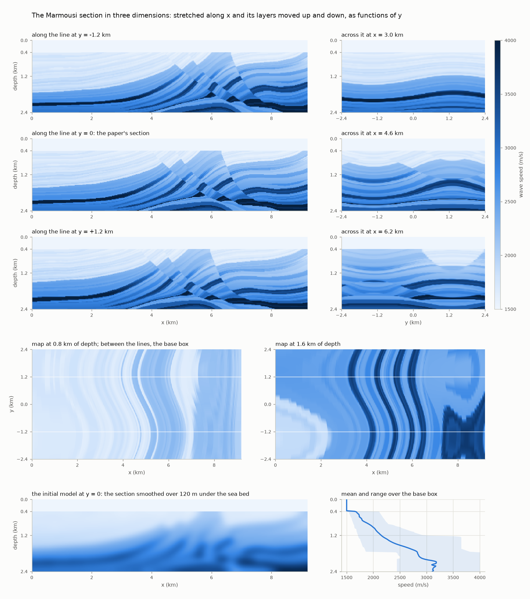
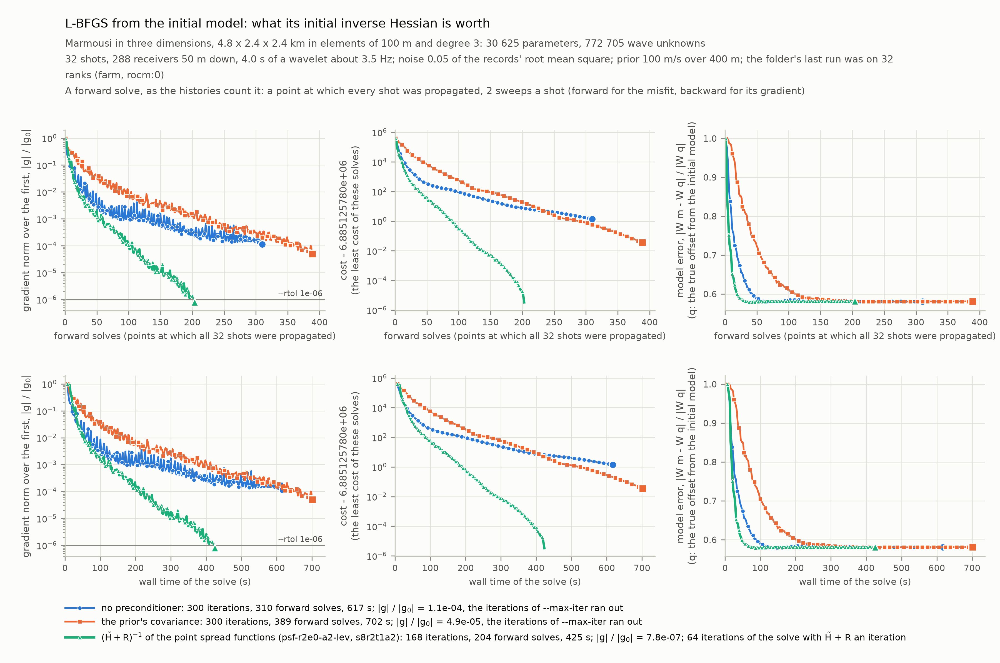

# The Marmousi model in three dimensions

The wave speed under a sea bed is inferred from the records of a seismic survey, with its
uncertainty: the problem of M. Hu, N. Alger, R. Nammour and O. Ghattas, *Accelerating seismic
inversion and uncertainty quantification with efficient high-rank Hessian approximations*
(arXiv:2507.10804, 2025), taken from the paper's two-dimensional section to a box in three
dimensions, with hIPPyMFEM on GPUs.  The acoustic wave equation is propagated for 4 s through
a box of 9.2 x 2.4 x 2.4 km whose middle plane is the paper's Marmousi section, once for each
of 138 sources under the surface of the sea; 2208 receivers record every shot; the unknown is
the wave speed at every vertex of the mesh, 444 185 values, as an offset from a smooth initial
model.  The solution is the paper's: the MAP point (the most probable model, given the data)
by L-BFGS whose initial inverse Hessian is a solve with an approximation of the Hessian, then
a Gaussian approximation of the posterior with that approximation as its precision, and a
Markov chain that proposes from it.

The approximation is the paper's point spread function method.  It takes a column of the
misfit Hessian of a seismic problem for the image of a point: an oscillating blob a few
wavelengths wide, whose shape changes slowly from place to place.  One product of the Hessian
with a comb, the sum of unit vectors at points further apart than a blob is wide, then gives
the columns of all its points at once.  The ice sheet application builds the whole Hessian
of its problem from such products (`../icesheet/localhessian.py`, whose comb loop this
application uses).  Here the combs stand on a sparse lattice of sample points, the Fourier
transform of each column (the Hessian's symbol at its point) is interpolated between them,
and the operator is applied by Fourier transforms of small boxes on the GPUs.

What it shows about the library: an approximation of the Hessian that an application brings
takes the three places the library has for one, with the library's algorithms unchanged: the
initial inverse Hessian of its L-BFGS operator, the preconditioner of `ReducedSpaceNewtonCG`
(through the model's `Rsolver`), and the Gaussian that `gpCNKernel` proposes from.  And on a
mesh of equal cubes the parameter space is a lattice: the prior, the point spread functions
and the solves with their sum work on a rank's block of it as arrays on the GPU, by stencils
and Fourier transforms, with one permutation between those arrays and the library's vectors.



*The model (`model.png` of `python marmousi.py figures`).  The plane `y = 0` is the paper's
section; away from it the section is stretched along the line and its layers are moved up and
down.  The box of the inversion lies between the white lines of the two maps.*

## The problem

| | the paper | here |
|---|---|---|
| equation | acoustic, constant density, two dimensions | the same in three dimensions |
| discretization | finite differences on a grid of 461 x 121 points, 20 m apart | spectral elements of degree 3 on cubes of 50 m, leapfrog: 11.6 million wave unknowns |
| model | Marmousi under 400 m of water, 9.2 x 2.4 km | that section as the plane `y = 0` of a box of 9.2 x 2.4 x 2.4 km |
| boundaries | not stated | a free surface on top; the four sides and the bottom absorb to first order |
| sources, receivers | 92 sources 100 m apart and 153 receivers 60 m apart, along the top | 138 sources on a grid of 400 m and 2208 receivers on a grid of 100 m, 25 m under the surface |
| source, record | a band of 4 to 10 Hz; 8 s in 4001 steps | a spectrum about 7 Hz with 13.5 % of its peak at 4 and at 10 Hz; 4 s in 2987 steps |
| parameter | the wave speed's offset from the initial model at the 55 781 points of the grid | the same offset, trilinear on the elements: 444 185 values at their vertices, 50 m apart |
| initial model | the true one smoothed by a Gaussian of 120 m | the same under the sea bed, the water kept |
| window on the unknown | one inside; a taper to zero over 30 points at the sides and 20 at the top and the bottom | the same in metres at the sides and the bottom (600 and 400 m); zero in the water |
| noise | a variance of 0.01 in the misfit | independent on every sample, a given fraction of the root mean square of the data |
| prior | bi-Laplacian about the initial model, variance 300 (m/s)^2 | the library's bi-Laplacian with a lumped mass about the initial model, a given standard deviation and correlation length |
| Hessian approximations | low rank, point spread functions (PSF), pseudo-differential probing (PDO), the two combined (PSF+) | point spread functions |
| point spread functions | 33 impulse responses from one Hessian product, 800 m apart; Gaussian weights; Fourier transforms of the whole grid | 20 from one product, 800 m apart, on the middle plane; trilinear weights; Fourier transforms of boxes of 32^3 points |
| MAP point | L-BFGS whose initial inverse Hessian is nothing, the prior's covariance or `(H~ + R)^-1`: 333, 465 and 231 steps (its Table 3) | the same three; or the library's Gauss-Newton-CG with the same three as preconditioners |
| posterior | the Laplace approximation with `H~` and a low-rank correction; gpCN | the Laplace approximation with `H~`, without a low-rank correction; gpCN and pCN |

`H~` is the approximation of the misfit's Hessian and `R` the prior's precision.  Where the
paper's text gives no number, the left column has that of its public code
(`github.com/mathewgaohu/lrs-psido`).

**The third dimension**, which Marmousi does not have.  The speed at a point is the
section's at a place that moves with `y`: the section is stretched along the line by up to
450 m and its layers are moved up and down by up to 150 m under the sea bed, by sines of `y`
with periods of 4.8 to 7.8 km (`marmousi.py` has the formula).  It is a formula of the point,
so every rank evaluates its own block and no array of the whole box exists.  It keeps what
the method leans on: the plane `y = 0` is the paper's section itself; the water stays the
flat layer it is, so the unknown can be held fixed in it; and every speed lies between the
section's least and greatest, 1500 and 4000 m/s, so the time step is known before a mesh
exists.  On a lattice coarser than the section's 20 m the section is first smoothed over
half a step of the lattice.

**The mesh and the band.**  Elements of degree 3 on cubes of 50 m: the shortest wave of the
band's upper end, 150 m at 10 Hz in the water, is three elements or nine nodes long.  The
time step is 0.8 of a bound in closed form on the leapfrog scheme's limit, for equal cubes
and speeds up to 4000 m/s: 1.34 ms, the same on every partition, with no power iteration.
The faces that absorb do so to first order, exactly for a wave that meets them head-on and
less at an angle (17 % of the amplitude comes back at 45 degrees); the data are made with
the same faces.  `--h` changes the element, and the band and the source's delay follow it
(10 Hz x 50 / h at the upper end), so that an element is the same part of a wavelength: the
small case of the results is a shorter box at 100 m and 2 to 5 Hz.

**The parameter** is trilinear on the elements, so its unknowns are the elements' vertices: a
lattice of 50 m where the paper's grid has 20 m.  A parameter finer than the elements would
be weighted unevenly by their quadrature (a lattice of 25 m by 1.08 and 0.92 in turn, in
every direction), the Hessian would carry that pattern with the period of an element, and
the method interpolates between sample points on the assumption that the Hessian changes
slowly.  The price is resolution.  The shortest wave the Hessian holds is `c / (2 f)`, 75 m
at 10 Hz and 1500 m/s: 3.75 steps of the paper's grid, and two steps of this lattice only
where the speed is above 2000 m/s.

**The unknown and the window.**  The speed is `c = c0 + W m`: `c0` the initial model, `m` the
unknown in m/s, and `W` the paper's window, one inside the box, falling to zero within 600 m
of the four sides and 400 m of the bottom, and zero in the water.  The propagator knows
nothing of the window.  Its parameter is the whole offset `q = W m`, and the Hessian of the
misfit with respect to `m` is `W H0 W`, with `H0` the Gauss-Newton Hessian with respect to
`q`.  The window is one at 132 825 of the 444 185 vertices and zero at 100 145.

**The survey and the record.**  A source costs a wave field and a receiver nothing, and the
paper's 100 m between sources would be 2208 of them in plan: they stand 400 m apart, the
depth of the water, and the receivers 100 m.  Both are 25 m under the surface, because the
pressure is zero on the surface itself and a source there radiates nothing.  The record is
4 s where the paper's is 8 s, for half the steps; the wave in the water alone takes 6.1 s
to cross the 9.2 km of the line, and such arrivals are not in it.  A shorter record is fewer
data, not an approximation.  The source's time function is a cosine of 7 Hz under a
Gaussian, which has died away 0.9 s after the record begins; the paper's own, a band-pass
of 4 to 10 Hz with a delay of 1 s, is `--wavelet paper`.

**The data and the prior.**  The data are made by the same propagator from the true model,
with independent Gaussian noise on every sample of every record, its standard deviation a
given fraction of the root mean square of the data without noise (`--noise`); the misfit is
half the sum of the squared residuals over that variance.  By default the true model is
`c0 + W (c_true - c0)`, which the unknown can reach; `--full-truth` takes the true speed
everywhere, also on the faces and in the margins, where the window keeps the unknown from
following it (the paper's situation).  The prior has a pointwise standard deviation
(`--prior-sigma`, 25 m/s) and a correlation length (`--prior-rho`, 200 m), and its two
coefficients are set from them on the lattice itself: at four vertices a correlation length
the continuous operator's formula would give 2.4 times the variance asked.

## How it is written

```python
def density(u, a, m, p, x, c0):
    return a.val * p.val / (c0 + m.val) ** 2 + hm.inner(u.grad, p.grad)
```

`u` is the pressure, `a` its second time derivative, `m` the offset of the wave speed from
the initial model `c0`, `p` the test function.  The stiffness has no coefficient, which is
what lets the propagator apply it to a rank's block of unknowns as one array.

* `../seismic/sem.py`, the seismic application's propagator (spectral elements, leapfrog, the
  adjoint and the Hessian actions by running the forward field backward), with three things
  added for this application, each off unless asked for.  Faces that let the waves out
  (`absorbing=`): a diagonal boundary mass at their nodes, with which the scheme can no
  longer be run backward there, so a forward sweep (the propagation through all the time
  steps) keeps the field's values at those nodes and the backward sweep takes them from it.
  A mesh of equal bricks (`brick=`, `lattice=`): one element's geometric factors for all,
  the unknowns numbered as the nodes of a 3D array, and the stiffness applied through slices
  of that array, with no table of indices.  Shots (`set_wavelets`): all the sources are the
  rows of one operator and a shot (one experiment: some sources fire, all receivers record)
  is a matrix of their amplitudes in time, so that nothing is compiled from one shot to the
  next.  And on several ranks the exchange of a step can go behind its update
  (`HIPPYMFEM_SEM_OVERLAP`, `auto` by default): the update is launched with a rank's own
  contributions, the neighbours' values arrive while the GPU computes it, and the rows that
  needed them (the shared unknowns and the absorbing nodes) are computed again from their old
  values by the same formulas, so that every copy of a shared unknown holds the same bits.
* `box.py`: a box of equal bricks, where everything a parallel run asks of a mesh is
  arithmetic on integers: the names of the nodes, the boundary mass of the absorbing faces,
  the element that holds a point, the bound on the time step.  The mesh is MFEM's Cartesian
  mesh in the ranks' blocks; a large one is a coarse box that every rank cuts for itself.
* `marmousi.py`: the data (`fetch` gets the paper's section and wavelet and the original
  model, and holds each against its checksum), the speed in three dimensions, the initial
  model, the window, the source's time function, the survey, and figures of them.
* `lattice.py`: the vertices as a lattice in blocks, one a rank.  The values of the
  neighbouring ranks around a block (a halo) are exchanged from GPU memory to GPU memory
  where the MPI library can; who sends what to whom is arithmetic on the ranks' numbers.
  `LatticeMap` is the permutation between a rank's block and the library's vector, and holds
  that arithmetic against MFEM's numbering on every rank when it is made.
* `prior.py`: `hm.BiLaplacianPrior` with a lumped mass as a stencil of 27 numbers passed
  twice over a block.  Its solve is a cosine transform where one rank holds the lattice
  (exact), a rank's own Fourier transform of its block with a halo on several ranks (to a
  tolerance, 1e-8), or a polynomial of the stencil where that halo would be too wide: no
  multigrid.
* `psf.py`: the point spread function operator and its sum with the prior, below.
* `model.py`: the shots and the inverse problem.  A pool of shots turns a model into a
  misfit, a gradient or a block of Hessian products, shot by shot, and keeps nothing of one
  shot for the next: a gradient is a forward sweep of one field and a backward sweep of two
  for every shot, a Hessian product on `D` directions two sweeps of `1 + D` fields.
  `MarmousiModel` is the `hm.Model` that the library's algorithms talk to; `PSFPosterior`
  the Laplace approximation, with the members `gpCNKernel` asks for.
* `run.py`: the inversion in stages (data, verify, psf, map, post, chain), each resuming
  what an earlier run saved.  `scale.py`: the times of the sweeps and of the operator on a
  box cut into blocks, at any size.

**The operator.**  With `x_k` the sample points and `*` a convolution:

```
p_k(y) = (H0 comb)(x_k + y) mask(y),  |y| <= rho    the impulse response at x_k, out of the comb's response
s_k    = max(Re FFT p_k, 0)                          its symbol: the real, positive part
g_k    = cut(IFFT sqrt(s_k))                         an even kernel of radius rho
S u    = sum_k w_k ((g_k + eta G) * u)               w_k: the hats of the sample points, which sum to one
H~     = W S S^T W                                   symmetric and positive semi-definite
```

The sample points stand `--psf-step` vertices apart (16: 800 m), where the window is one and
at least `rho` vertices (`--psf-rho`, 8) from where it is not.  The combs, the mask, the real
positive part and the square root are the paper's code's; so is the low-frequency term
`eta G`, a Gaussian blur that the code adds to `S` before it forms the preconditioner, here
with a fraction of the largest square-root symbol as its weight (`--psf-eta`, 0.1; the
results below are better without it).  What is
not the paper's:

* The transforms are local.  The paper's operator takes Fourier transforms of the whole
  grid, `3 K + 1` of them a product for `K` sample points.  Here a rank transforms boxes of
  its own: for every cell of the sample points' lattice the cell and a margin of the
  kernel's radius (16 + 2 x 8 = 32 vertices a side), in which the weights of the cell's
  eight corners are the only ones that are not zero.  The convolution on a box is exact on
  its cell, so the operator is defined without reference to boxes or ranks, its transpose is
  exact, and a rank needs its neighbours' values within the kernel's radius and nothing
  else: one exchange for `S` and one for `S^T`.  `H~` and `W S` leave out the boxes of tiles
  on which the window is zero, and a product is one compiled call
  (`HIPPYMFEM_PSF_WHOLE`: `0` runs the batches from Python, with the same bits).
* The weights are the trilinear hats of the sample points.  The paper's are Gaussians
  normalized to sum to one, which are not compact.
* The window is applied, not interpolated.  The combs go through `H0` and `W` stands on both
  sides of `S S^T`; the paper's code takes the impulse responses of `W H0 W` and multiplies
  the weights by `W`.  A window that falls to zero within a step of the sample points is not
  the interpolant of its values at them.
* The paper's high-pass filter, which takes the smooth, non-local part of the Hessian out of
  what the combs see, is an option that is off (`--psf-filter`).

The Hessian of the posterior is approximated by `H~ + R`, which is one object in three
places.  A solve with it, by conjugate gradients on arrays of the GPU, is the initial
inverse Hessian of L-BFGS and the preconditioner of Newton's conjugate gradients.  Those
inner conjugate gradients are preconditioned in their turn (`--inner-precondition`): with
the prior's solve (`prior`, the default), with an approximate inverse made of the kernels'
and the prior's symbols and applied as the operator is (`symbol`), with the same beside an
exact solve with the prior (`split`), or not at all (`none`, as the paper's code solves, to
1e-15).  As the precision of the Laplace approximation `H~ + R` gives samples by one solve
each, `(H~ + R)^-1 (R s + W S xi)` with `s` a sample of the prior and `xi` white noise:
because `H~` is given as a square, these are samples of that Gaussian itself, to the
tolerance of the solve.  The L-BFGS loop is the driver's own, around the library's
`BFGS_operator` and `armijo_backtrack`, for a record and a checkpoint of every iteration
and for the paper's code's rescaling of the initial inverse Hessian at every step.

**Two layouts** (`--layout`).  A box that one GPU holds is not cut: with `farm`, the
default, every rank holds the whole box on its own GPU and a share of the shots, the first
rank holds the parameter space and runs the stages, and the others do the sweeps they are
told; nothing is exchanged inside a sweep, so 32 GPUs do 32 shots in the time of one.  With
`decomposed` one box is cut into the ranks' blocks and every rank takes part in every shot
and in every operation on the lattice: for a box that no GPU holds, and what `scale.py`
measures.

## Running it

From this directory:

```
python marmousi.py fetch                 # the section, the paper's wavelet and the original model into data/ (7 MB)
python marmousi.py figures out/model     # the model, the window, the wavelets and the survey as figures
export HIPPYMFEM_DEVICE=gpu

# the small case (4.8 x 2.4 x 2.4 km in elements of 100 m, 2 to 5 Hz, 32 shots) on 8 GPUs:
# the data, the checks of gradient and Hessian, the operator and what it is worth
S="--size 4800,2400,2400 --h 100 --source-step 600 --receiver-step 200 --depth 50 --margins 400,400,300
   --noise 0.5 --prior-sigma 25 --prior-rho 400 --psf-step 8 --psf-rho 4"
mpirun -n 8 ../../tools/mpirun_pinned.sh python run.py $S --out out/small --stages data,verify,psf
# its MAP point three times, side by side in the folder: L-BFGS from nothing, from the prior, from the operator
mpirun -n 8 ../../tools/mpirun_pinned.sh python run.py $S --out out/small --stages map --precondition none
mpirun -n 8 ../../tools/mpirun_pinned.sh python run.py $S --out out/small --stages map --precondition prior
mpirun -n 8 ../../tools/mpirun_pinned.sh python run.py $S --out out/small --stages map --precondition psf
# the Laplace approximation at the last one's MAP point, and the chains from it
mpirun -n 8 ../../tools/mpirun_pinned.sh python run.py $S --out out/small --stages post,chain --precondition psf \
    --chain-steps 40
# the MAP point again by the library's Gauss-Newton-CG with the operator as its preconditioner
mpirun -n 8 ../../tools/mpirun_pinned.sh python run.py $S --out out/small --stages map --map-solver newton \
    --precondition psf
# one GPU does the same; without --stages: data, psf, map, post
python run.py $S --out out/small1

# the paper's box (the defaults: 9.2 x 2.4 x 2.4 km in elements of 50 m, 4 to 10 Hz, 138 shots), a shot a GPU;
# its MAP solves are the small case's lines, with --time-limit where a job is shorter than the solve
B="--noise 0.05 --prior-sigma 100"
mpirun -n 138 ../../tools/mpirun_pinned.sh python run.py $B --out out/base --stages data,verify,psf --time-limit 900

# the small case with a tenth of the noise and a prior of 100 m/s, where the data hold the model, on 32 GPUs,
# with the settings of the operator that the results recommend (a mask of radius 2, no low-frequency term)
T="--size 4800,2400,2400 --h 100 --source-step 600 --receiver-step 200 --depth 50 --margins 400,400,300
   --noise 0.05 --prior-sigma 100 --prior-rho 400 --psf-step 8 --psf-rho 2 --psf-eta 0 --psf-amplitude 2"
mpirun -n 32 ../../tools/mpirun_pinned.sh python run.py $T --out out/t --stages data,psf
mpirun -n 32 ../../tools/mpirun_pinned.sh python run.py $T --out out/t --stages map --precondition psf \
    --inner-precondition levels --inner-rtol 1e-3
mpirun -n 32 ../../tools/mpirun_pinned.sh python run.py $T --out out/t --stages map --precondition none

# the box cut into the ranks' blocks in the place of the shots shared out
mpirun -n 8 ../../tools/mpirun_pinned.sh python run.py $S --out out/blocks --layout decomposed --stages data,verify,psf

# the times of the sweeps and of the operator on a box in blocks: --cells are the elements of ONE rank's
# block and --grid the blocks, so the load of a rank stays and the box grows with the ranks
mpirun -n 8 ../../tools/mpirun_pinned.sh python scale.py --cells 96,96,48 --grid 2,2,2 --check --out out/s8.json
# a GPU's fill of it, 192 million wave unknowns a rank: in cubes, and in columns from the top to the bottom
mpirun -n 8 ../../tools/mpirun_pinned.sh python scale.py --cells 192,192,192 --grid 2,2,2 --check --overlap-both \
    --out out/b8.json
mpirun -n 8 ../../tools/mpirun_pinned.sh python scale.py --cells 384,384,48 --grid 4,2,1 --check --out out/c8.json
# their one-rank point, with the prior's solve that several ranks take
python scale.py --cells 192,192,192 --grid 1,1,1 --check --prior-solver fft --out out/b1.json
# the operator's kernels from one true Hessian product in the place of a formula
mpirun -n 8 ../../tools/mpirun_pinned.sh python scale.py --cells 48,48,24 --grid 2,2,2 --tile 1,1 --check \
    --psf-kernels comb --steps 1200 --out out/k8.json
# one box on two grids of ranks must give the same sums: the records side by side (no MPI, no GPU)
mpirun -n 8 ../../tools/mpirun_pinned.sh python scale.py --cells 48,48,24 --grid 2,2,2 --tile 1,1 --check --out out/a8.json
python scale.py --cells 96,96,48 --grid 1,1,1 --tile 1,1 --check --out out/a1.json
python scale.py --compare out/a1.json out/a8.json
```

The stages of `run.py`: `data` makes the records; `verify` holds the gradient and the
Hessian against differences; `psf` takes the comb's product at the initial model, builds the
operator and measures it; `map` finds the MAP point; `post` builds the operator again at the
MAP point and draws from the Laplace approximation; `chain` runs gpCN and pCN from there.
`run.py --help` lists the options by group.  `--out` is a folder, and one inversion is
several runs into it: a stage reads what the folder holds and does what is missing, and a run
with other options that define the problem is refused (it says which differ).  Everything on
the lattice is saved whole and in the lattice's own order, whatever the ranks and the layout
that wrote it.  A stage that passes `--time-limit` stops at its next checkpoint (an L-BFGS
iteration, a round of shots of a block of Hessian products, a step of a chain), and the same
command goes on from there.  The MAP solves are filed by `--tag`, by default the solver and
its preconditioner (`lbfgs-psf`, `lbfgs-prior`, ...), and the products with the combs by the
sample points' step, the mask's radius, `--psf-teeth` and the filter: `--precondition psf`
needs the stage `psf` of the same four.  The estimate is `initial.npy + window.npy *
map_<tag>.npy` in the folder, arrays `[k, j, i]` with the depth first.

What to read first in the output of the stage `psf` (a check of the construction; what the
operator is worth to L-BFGS only the stage `map` says): `|H~ v - H v| / |H v|`, the error of
the operator on vectors it was not made from (white ones, and samples of the prior), against
the Hessian's own products with them, which are taken in the same sweeps as the comb's; the
largest symbol of `H~` over the prior's at the sample points of each depth, which says where
the data hold the model and where the prior does (it goes as the square of `--prior-sigma`
over `--noise`); and the iterations of a solve with `H~ + R` for each inner preconditioner.

`scale.py --help` says what each time it prints and records is: of a sweep the time of a
step, and over the ranks a rank's own work and its time in the exchange; of the operator's
products and of an iteration of the solve the same, with the time in the transforms apart.
`--overlap-both` times the three sweeps a second time with the exchange of a step the other way
and holds the two ways' results against each other.  `--check` holds the identities that must
be round-off at any size (`<J dm, q> = <dm, J^T q>`
of the sweeps, `<S u, c> = <u, S^T c>`, the symmetry of `H~` and of `R`).  The series of the
results go on with `--grid 4,4,4`, `8,8,8`, `16,16,16` for the cubes and `8,8,1`, `32,16,1`,
`64,64,1` for the columns.

`marmousi.py fetch` needs a connection to the internet, which on a cluster is the login
node's; `MARMOUSI_DATA` names another folder than `data/` for the three files.  Nothing in
the application is written for one GPU vendor: the propagator, the operator and the prior
are JAX, the mesh and the parameter's space are MFEM's, and no solver of hypre is called.
It has been run on AMD cards only (the MI250X of Frontier, and an MI210 for small tests),
behind Slurm's launcher in the place of `mpirun`:

```
export HIPPYMFEM_DEVICE=gpu HIPPYMFEM_NODE_GPUS=8
srun -N 1 -n 8 --ntasks-per-node=8 -c 7 --gpus-per-task=1 --gpu-bind=closest \
    env ROCPROFILER_REGISTER_ENABLED=0 python run.py $S --out out/small --stages data,verify,psf
srun -N 1 -n 8 --ntasks-per-node=8 -c 7 --gpus-per-task=1 --gpu-bind=closest \
    env ROCPROFILER_REGISTER_ENABLED=0 MPICH_GPU_SUPPORT_ENABLED=1 \
        LD_PRELOAD=$CRAY_MPICH_ROOTDIR/gtl/lib/libmpi_gtl_hsa.so \
    python scale.py --cells 96,96,48 --grid 2,2,2 --check --out out/s8.json
```

`HIPPYMFEM_NODE_GPUS` tells the library how many GPUs a node has, so that its eight ranks are
not taken to share the one that each of them sees; `mpirun_pinned.sh` sets it itself.  The
second form is Cray MPICH with its GPU support, with which the exchanges of the decomposed
layout go from GPU memory to GPU memory (`HIPPYMFEM_DEVICE_MPI`, as in the seismic
application); the `farm` layout sends arrays of the host and does not need it.

## Results

All on Frontier (AMD MI250X; a rank has one of a card's two GPUs, 64 GiB), in double
precision.  The records are in the results folder named at the end.

**The small case** (27 648 elements of 100 m, 772 705 wave unknowns, 30 625 parameters; 32
shots of 1494 steps, 288 receivers), a shot a GPU on 32 GPUs.  On two of the shots the
gradient agrees with central differences of the cost to 1.7e-3, 1.7e-5 and 1.7e-7 for steps
of 1, 0.1 and 0.01 of a sample of the prior, and the Gauss-Newton Hessian with differences of
the gradient to 6.4e-3, 6.5e-5 and 6.5e-7 (with data made at the point, where it is the
Hessian); `(H0 u, v) = (H0 v, u)` holds to 2.6e-15.  The data take 5 s, these checks 44 s,
and the products with the comb and four check vectors, five directions in one pair of sweeps
a shot, 5 s.  The same folder made as a farm on 1, 2 and 8 GPUs agrees to 1e-15 in the
records and to 1e-8 in the L-BFGS iterates (the tolerance of the inner solve); made on two
and on eight blocks of the decomposed layout it agrees to the tolerance of the prior's solve
on several ranks, 1e-8.

**Three initial inverse Hessians for L-BFGS.**  A "solve" below is a point at which every
shot was propagated (a forward sweep for the misfit and a backward sweep for its gradient).
With noise at half the root mean square of the data and a prior of 25 m/s over 400 m, where
the data dominate the prior only at the longest waves (73 times, 800 m down), to a gradient
of 1e-6 of the first:

| `--precondition` | iterations | solves | on 32 GPUs |
|---|---:|---:|---:|
| `none` | 100, not there (2.5e-6) | 108 | 197 s |
| `prior` | 26 | 34 | 66 s |
| `psf` (mask of radius 4, `--psf-eta 0.1`) | 24 | 26 | 125 s |

All three end at the same point, near the start: with this much noise the data hold the
long waves under the sea bed and little else.  With a tenth of the noise and a prior of
100 m/s, the data hold the model (the largest symbol of `H~` is 1.2e5 times the prior's at
800 m) and the estimate moves to 0.58 of the initial model's distance from the truth.  The
solves at which the gradient passes each power of ten of the first:

| `--precondition` | 1e-1 | 1e-2 | 1e-3 | 1e-4 | 1e-5 | at the end | cost above the least after 100 solves |
|---|---:|---:|---:|---:|---:|---|---:|
| `none` | 8 | 27 | 87 | | | 1.1e-4 after 310 solves (300 iterations), 617 s | 94 |
| `prior` | 25 | 84 | 208 | 353 | | 4.9e-5 after 389 solves (300 iterations), 702 s | 535 |
| `psf`, mask of radius 2, `--psf-eta 0` | 12 | 28 | 63 | 111 | 165 | 2.0e-6 after 203 solves, 1501 s (its time limit) | 1 |
| the same, `--inner-rtol 1e-3` | 12 | 28 | 60 | 109 | 166 | 3.1e-6 after 190 solves, 901 s (its time limit) | 1 |
| the same with `--psf-amplitude 2` | 9 | 23 | 52 | 95 | 144 | 9.5e-7 after 199 solves (166 iterations), 1018 s | |
| the same with `--inner-precondition levels` | 9 | 22 | 52 | 101 | 154 | 7.8e-7 after 204 solves (168 iterations), 425 s | |



*The second table's solves without a preconditioner, with the prior, and with the operator as in its last row (`--psf-amplitude 2 --inner-precondition levels --inner-rtol 1e-3`), by `python figures.py FOLDER --only convergence`.*

The point spread functions halve the solves to 1e-3 against no preconditioner and reach
1e-4 and 1e-5 where neither of the others does in 300 iterations; the prior alone is the
worst, as in the paper (465 steps against 333 without one and 231 with the point spread
functions there).  The first steps are the exception: to 1e-1 L-BFGS without a
preconditioner takes 8 solves and with the operator 12.  Two choices made that difference,
and both are options: with the mask of radius 4 and the low-frequency term of the paper's
code (`--psf-eta 0.1`) the operator was behind L-BFGS without a preconditioner all along
(model error 0.79 after 23 solves, against 0.67).  The impulse responses are 8 lattice
points apart there, and a mask of radius 4 takes in up to a fifth of the neighbouring
teeth's responses; the low-frequency term is too large for this Hessian.  In wall time
the inner solve is what the operator costs: about 1200 conjugate gradient iterations with
the prior as preconditioner for each solve with `H~ + R` at the default `--inner-rtol 1e-6`,
at 5 ms each on the first rank's GPU, against 2 s for the sweeps of a solve on 32 GPUs.  To
1e-3 it does not change the outer iterations (above), and it halves that cost.  Seconds on
32 GPUs to a gradient of 1e-2, 1e-3, 1e-4 and 1e-5 of the first:

| `--precondition` | 1e-2 | 1e-3 | 1e-4 | 1e-5 |
|---|---:|---:|---:|---:|
| `none` | 58 | 175 | not in 617 | |
| `prior` | 154 | 376 | 636 | not in 702 |
| `psf`, `--inner-rtol 1e-3` | 132 | 278 | 510 | 782 |
| the same with `--psf-amplitude 2` | 132 | 272 | 486 | 737 |
| `psf`, `--inner-rtol 1e-3 --inner-precondition levels` | 63 | 135 | 230 | 341 |
| the same with `--psf-amplitude 2` | 54 | 114 | 214 | 322 |

With the inner solve's preconditioner `levels` (below) the operator is as fast as no
preconditioner to 1e-2 and faster from there on: 1e-3 in 114 s where L-BFGS without one takes
175 and with the prior 376, and 1e-6 in 425 s, which neither of them reaches.

What the operator still gets wrong, measured on the steps of these solves (the pairs of
steps and gradient differences that L-BFGS keeps): its size.  It holds 0.4 of the Hessian's
diagonal in the first rows under the sea bed, where three quarters of a white vector's
`|H v|^2` lie and no sample point stands, and 4.5 to 6 times it at the bottom; along its own
first steps it is 5 times too small on average.  An amplitude field `a(x)`, estimated from
the products with white vectors that the stage `psf` already makes, `H~ = W a S_n S_n^T a W`
with the kernels of `S_n` read off the responses divided by `a` at both ends
(`--psf-amplitude`, the width in nodes of the Gaussian that smooths the estimate; off by
default), corrects that: the operator's diagonal over the Hessian's then runs from 0.62 to
0.96 with depth where it ran from 0.40 to 4.5, and the L-BFGS solve with it (the last row of
the table) is the only one of these that reaches 1e-6, in 199 solves and 1018 s.  The driver's own measure, `|H~ v - H v| /
|H v|` on white vectors and on samples of the prior (0.52 to 0.70 in every case here), does
not tell these operators apart, and is no guide to what the operator is worth to L-BFGS.

The inner solve itself: a product with `H~` was a hundred small calls from Python and is
now one compiled call (`HIPPYMFEM_PSF_WHOLE`, default `auto`), 9.5 ms where it took 47.5 on
461 041 lattice points, with the same bits.  Its conjugate gradients take about 1200
iterations with the prior's preconditioner, and the symbol-space ones (`--inner-precondition
symbol`, `split`) do little better: they interpolate the inverse between the corners of a
cell, and between a corner where the window is zero and one where it is one that inverse
changes by the square root of the data's dominance.  Without the window the symbol form
takes 57 iterations where the prior takes more than 1200.  `--inner-precondition levels`
interpolates over the window's values as well: the factor's kernels are those of
`(s_k / u_l^2 + r)^(-1/2)` at levels `u_l` of `u = 1 / W` four times apart, weighted at every
node by hats in its own `u`, so the inverse follows the window from node to node.  It takes
57 iterations with the window, about 60 an L-BFGS iteration in the runs above against 750
with the prior's, and is symmetric and positive by construction.

**The paper's box** (423 936 elements of 50 m, 11 626 825 wave unknowns, 444 185
parameters; 138 shots of 2987 steps, 2208 receivers), a shot a GPU on 138 GPUs.  A forward
sweep of a shot takes 4.1 s and the data of all shots 11 s; the products with the comb and
four check vectors 60 s; `(H0 u, v) = (H0 v, u)` holds to 1.0e-14.  No MAP point has been
computed at this size.

**Weak scaling of the sweeps.**  `scale.py --check --overlap-both` gives every rank the same
block and times the three sweeps (one field forward; two fields forward, as a Hessian
product's incremental solve; two fields backward, as an adjoint solve) over 100 steps, with
the exchange of a step behind its update and between the halves of the step, in one run.
Cubes of 192^3 elements a rank (`--cells 192,192,192 --grid P,P,P`; `4,4,2` on 32), 192
million wave unknowns, five absorbing faces; milliseconds a step and percent of one GPU's
18.66, 51.58 and 59.73 ms:

| GPUs | wave unknowns | exchange behind the update | of one GPU, % | exchange between the halves | of one GPU, % |
|---:|---:|---|---|---|---|
| 8 | 1 532 808 577 | 19.50 / 53.38 / 61.53 | 95.7 / 96.6 / 97.1 | 19.86 / 53.18 / 61.34 | 93.9 / 97.0 / 97.4 |
| 32 | 6 125 917 825 | 19.70 / 53.45 / 61.85 | 94.7 / 96.5 / 96.6 | 20.22 / 54.39 / 62.11 | 92.3 / 94.8 / 96.2 |
| 64 | 12 246 522 625 | 20.13 / 54.58 / 62.57 | 92.7 / 94.5 / 95.4 | 20.74 / 55.56 / 63.17 | 90.0 / 92.8 / 94.5 |
| 512 | 97 908 438 529 | 20.05 / 54.37 / 62.59 | 93.1 / 94.9 / 95.4 | 21.16 / 56.39 / 64.23 | 88.2 / 91.5 / 93.0 |
| 4096 | 783 012 621 313 | | | 21.38 / 56.80 / 64.64 | 87.3 / 90.9 / 92.2 |

Columns from the top to the bottom of the box (`--cells 384,384,48 --grid P,Q,1`), as many
elements, 6 % faster a step than cubes on one GPU (17.60, 49.27, 57.46 ms):

| GPUs | wave unknowns | exchange behind the update | of one GPU, % | exchange between the halves | of one GPU, % |
|---:|---:|---|---|---|---|
| 8 | 1 540 443 025 | 17.89 / 49.33 / 57.85 | 98.4 / 99.9 / 99.3 | 18.37 / 49.97 / 58.44 | 95.8 / 98.6 / 98.3 |
| 32 | 6 159 767 185 | 17.85 / 49.31 / 57.94 | 98.6 / 99.9 / 99.2 | 18.53 / 50.60 / 58.89 | 95.0 / 97.4 / 97.6 |
| 64 | 12 318 197 905 | 17.80 / 49.49 / 57.77 | 98.9 / 99.6 / 99.5 | 18.49 / 50.93 / 58.73 | 95.2 / 96.7 / 97.8 |
| 512 | 98 532 219 025 | 17.82 / 49.23 / 57.78 | 98.8 / 100.1 / 99.4 | 18.56 / 50.57 / 58.70 | 94.9 / 97.4 / 97.9 |

The two ways give the same records, the same `J dm` to 1e-15 and the same gradients, and the
adjoint identity holds to round-off in every run.  What the series loses is the exchange: on
4096 GPUs every rank spent at least 1.9 ms of a 21.4 ms step in it (26 neighbours), and the
slowest GPUs' own work set the pace (18.4 to 19.5 ms).  Behind the update the exchange costs
what the extra rows of the step cost, about half a millisecond on eight GPUs, so the
default (`HIPPYMFEM_SEM_OVERLAP=auto`) takes it only where the exchange goes from GPU memory
to GPU memory and a rank holds at least 16 million unknowns times the fields.  The 4096 row
is the step before this change; on 4096 GPUs the forward sweep makes 3.7e13 unknown-updates
a second, and the set-up of mesh, names and propagator takes 122 s (60 s on one GPU).  At a
small load the exchange is not small (12 million unknowns a rank: 1.26 ms a step on one GPU
and 1.54 to 1.58 on eight), which is why a box that one GPU holds is not cut and its shots
are shared out.

**The operator and the solve with `H~ + R`**, on the same blocks (7.2 million lattice points
a rank, sample points 16 apart, kernels of radius 8), milliseconds:

| GPUs | lattice points | a product with `H~` | of one GPU | an iteration of the solve, the prior's preconditioner | of one GPU |
|---:|---:|---:|---:|---:|---:|
| 1 | 7 189 057 | 88.3 | | 95.3 | |
| 8 | 57 066 625 | 93.6 | 94.4 % | 105.5 | 90.3 % |
| 32 | 227 673 985 | 94.4 | 93.6 % | 110.6 | 86.2 % |
| 64 | 454 756 609 | 95.9 | 92.1 % | 114.6 | 83.1 % |
| 512 | 3 630 961 153 | 97.6 | 90.5 % | 119.8 | 79.5 % |

In columns on 512 GPUs the product takes 94.3 ms and the iteration 109.9.  In a product a
rank waits only for its neighbours (two exchanges of a halo of 8 points, 4 to 8 ms); in an iteration of the solve it also waits at three inner products for every other
rank, and the prior's solve on several ranks is a rank's own transform with a wide halo.  Two changes since the first series (14 million points a rank, to 4096
GPUs, where a product took 230 ms on one GPU and 214 to 238 on 4096): the boxes of tiles on
which the window is zero are left out of `H~` (a block on a low face of the box owned a
layer of boxes more than the others), and a product is one compiled call.  In that first
series an iteration of the solve kept 82 % of one GPU on 4096 (301.5 against 246.0 ms):
every rank waits at each inner product for the slowest block.

**What has not been run.**  `--psf-amplitude` and `--inner-precondition levels` have run
as a farm only (the lattice on one GPU), not in the decomposed layout.
On Frontier: the stages `post` and `chain`, the Gauss-Newton-CG solver and a MAP point of
the paper's box; `post` and the chains have run on one GPU of the small case and on a host,
the Gauss-Newton-CG solver on a host.  None of the runs used the high-pass filter, the
paper's wavelet, single precision in an inversion or a survey of tiles (`--tile`).  In the
decomposed layout the records of all receivers are gathered on every rank, which a survey
of the paper's density on thousands of ranks would not bear: `scale.py` keeps to four
receivers around every source.
