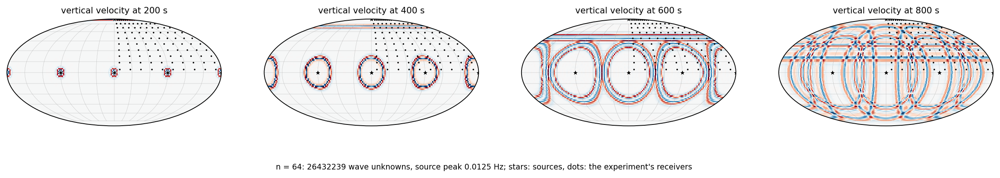

# Global seismic inversion

The Earth's wave speed is inferred from seismograms, with its uncertainty: the problem
of T. Bui-Thanh, C. Burstedde, O. Ghattas, J. Martin, G. Stadler and L. C. Wilcox,
*Extreme-scale UQ for Bayesian inverse problems governed by PDEs* (Proceedings of SC12,
2012), with hIPPyMFEM on GPUs.  The acoustic wave equation is propagated through a ball
of radius 6371 km for 1000 s from five simultaneous sources; 100 receivers on one quarter
of the surface record the ground motion; the unknown is the wave speed at every vertex of
the mesh, with the radial model PREM as the prior mean and PREM plus the tomographic
model S20RTS as the truth behind the synthetic data.  The solution is the paper's: the
MAP point by inexact Gauss-Newton-CG, then a Gaussian approximation of the posterior from
a randomized low-rank approximation of the prior-preconditioned Hessian of the misfit.

What it shows about the library: a time-dependent, explicitly stepped problem fits the
same programming model as the stationary ones.  The wave equation is given as a density
at a point, like every other PDE here; the inverse problem is an object with the methods
that `ReducedSpaceNewtonCG`, `ReducedHessian`, `MultiVector` and `GaussianLRPosterior`
call, and those are used unchanged.



*What the data are made of: the waves of the five sources crossing the receivers'
quarter of the surface.*

## The problem

| | the paper | here |
|---|---|---|
| equation | acoustic, velocity and dilatation (first order) | the same in its pressure form (second order) |
| discretization | discontinuous Galerkin, degree 3, RK4 | continuous spectral elements, degree 3, leapfrog |
| mesh | 13 warped cubes, adaptive octrees | 13 warped cubes, conforming |
| adjoint and Hessian | checkpointing: 5 wave solves per Hessian action | time reversal: 2 sweeps of 2 fields, nothing stored |
| sources, receivers | 5 simultaneous point sources; 100 receivers | the same; a Ricker wavelet in time |
| data | first 61 Fourier coefficients of each seismogram, noise 9.34e-3 | the same |
| parameter | wave speed, trilinear, 1 067 050 unknowns | wave speed minus PREM, trilinear, 987 387 unknowns |
| prior | PREM mean; squared inverse of an anisotropic elliptic operator | the same, with the coefficients of the paper's companion (Bui-Thanh, Ghattas, Martin, Stadler, SIAM J. Sci. Comput. 2013, section 6.2) as its figures have them: 0.15 km/s near the surface and 0.10 at the centre, correlated over 4500 km along the surface and a fifth of that across it |
| truth | PREM + S20RTS | PREM + S20RTS, its shear anomalies taken as they are (up to 0.4 km/s), the amplitude of the paper's figures |
| low rank | 488 Hessian products, single pass | 800, single pass, 8 to a pair of sweeps |

A conforming mesh has its largest elements at the surface, where the waves are slowest,
so at the paper's element count it resolves a lower frequency than the paper's adapted
mesh: the default peak frequency follows the mesh (0.0125 Hz at `--n 64`; the paper's
0.028 Hz needs 11.6 million elements, which is run here for the wave solves, the
gradient and the Hessian action).

## How it is written

```python
def density(u, a, m, p, x, rho, c0):
    return a.val * p.val / (rho * (c0 + m.val) ** 2) + hm.inner(u.grad, p.grad) / rho
```

`u` is the pressure, `a` its second time derivative, `m` the parameter, `p` the test
function; `rho` and `c0` are PREM at the point.  This is all the physics the propagator
is given: it takes the mass and stiffness coefficients from it by JAX, and the derivative
of the mass coefficient in `m` for the sensitivities.

* `sem.py`, the propagator.  Spectral elements on Gauss-Lobatto nodes (a diagonal mass
  matrix, the stiffness applied matrix-free) and leapfrog, which is exactly reversible: a
  forward solve keeps its seismograms and its last two states, and the adjoint sweep runs
  the forward field backward next to the adjoint field.  A Gauss-Newton Hessian action is
  one sweep forward and one backward, and several actions share one forward field.  Each
  rank holds its elements' unknowns on its GPU; the results do not depend on the number
  of ranks.
* `model.py`: `SeismicModel` subclasses `hm.Model` and overrides what touches the PDE;
  the data map (integrate to velocity, take 61 Fourier coefficients); the randomized
  low rank with its products taken in batches.
* `earth.py`: PREM, S20RTS, the mesh of a central cube and two shells of six blocks,
  warped analytically so that the core-mantle boundary and the surface are spheres.
* `run.py`: the inversion in stages (data, verify, map, eig, post).  `scale.py`: the
  throughput of the sweeps at any size, with the adjoint identity.  `figures.py`: the
  figures of a run.
* `tail_check.py`, `laplace_check.py`, `exact_samples.py`: the checks of a finished
  run's posterior that the results below quote.

## Running it

From this directory:

```
python earth.py fetch                 # S20RTS's coefficients into data/
export HIPPYMFEM_DEVICE=gpu

# a small complete run on one GPU, two minutes, and its figures
python run.py --n 16 --noise 2e-4 --rank 120 --out out/n16
python figures.py out/n16

# the paper's size on one H200 (seven hours; an 80 GB card needs --element-chunk 10000 in the place of 0)
HIPPYMFEM_HYPRE_DEVICE=1 python run.py --n 64 --element-chunk 0 --rank 800 --oversample 12 \
    --var-samples 3000 --resume --out out/n64
# its low rank and posterior on several cards, the MAP point being there (five H100: 80 minutes)
mpirun -n 5 ../../tools/mpirun_pinned.sh python run.py --n 64 --element-chunk 10000 --element-block 524288 \
    --rank 800 --oversample 12 --var-samples 3000 --nsamples 12 --stages eig,post --ensemble --out out/n64
# how good that low rank is: its eigenpairs, and what its subspace leaves out (8 starts, 10 Lanczos steps; one card)
SIZE="--n 64 --element-chunk 10000 --element-block 524288 --rank 800 --oversample 12 --out out/n64"
python tail_check.py out/tail 8 10 $SIZE
# samples of the posterior itself, 16 of them with 10 iterations each (seed 1; one card, a job per seed)
python exact_samples.py out/exact 16 10 1 $SIZE

# throughput of the three sweeps at any size, with the adjoint identity
mpirun -n 4 ../../tools/mpirun_pinned.sh python scale.py --n 96 --steps 40 --check
```

`run.py --help` lists the options.  A run saves its fields in an order that does not
depend on the partition, so `--resume` continues from any stage on any number of ranks,
with the options that define the problem as they were (it says which differ).  One
exception: the products of a single-pass low rank belong to their random directions,
which change with the number of ranks, and are taken again when that number changed.

Nothing in the application belongs to one GPU vendor: the propagator is JAX, the mesh and
the prior are MFEM and hypre.  It has been run on NVIDIA cards.  `earth.py fetch` needs a
connection to the internet, which on a cluster is the login node's.

## Results

At the paper's size (`--n 64`: 974 848 elements, 26.4 million wave unknowns, 987 387
parameters, 2510 time steps), the MAP point on one H200 and the low rank on five H100
(`--ensemble`):

| | here | the paper |
|---|---:|---:|
| Gauss-Newton iterations, Hessian actions for the MAP point | 12, 359 | 320 Hessian actions |
| Hessian products of the low rank, eigenvalues above 1 | 800, 472 (600 in a double pass of 1600) | 488 products |
| correlation of the MAP point with the truth under the receivers | 0.87 | |
| prior variance removed under the receivers, on average | 92 % | |
| the truth within two posterior standard deviations, whole mantle | 95 % | |
| MAP point, low rank | 4.7 h, 1.3 h | |

The MAP point follows the truth under the receivers and stays at the prior mean
elsewhere, and samples of the posterior follow the MAP point there (a draw differs from
it by 0.04 km/s where the truth varies by 0.10), as those of the paper's Figure 6 do.

Two checks of this posterior (`laplace_check.py`, which solves the wave
equation at draws of it).  The Gaussian approximation is good at this frequency: at four
draws the negative log posterior is within 7 of its Gauss-Newton quadratic model, on 800.
The low rank is not converged: on its own draws it holds 30 % of the Gauss-Newton
curvature `1/2 delta^T H delta` (241 of 811).

**How far the low rank is from converged** (`tail_check.py`).

* The single pass, the paper's algorithm, gives poor eigenpairs where the spectrum is
  flat.  The Rayleigh quotient `u^T H u` of the first is 1.08 times its eigenvalue on
  file, of the 55th 1.5 times, of the last 4.2 times, and from the 35th on the residual
  `|R^-1 H u - lambda u|` is larger than the eigenvalue itself.
* A double pass on the same 800 directions (`--double-pass`: 1600 products, 2.4 hours on
  five H100) has the eigenvalues of the Hessian on that subspace: 600 above 1 where the
  single pass has 472, the last 0.33 for 0.13, up to 2.5 times the single pass's.  The
  posterior moves much less, because it is the large eigenvalues that set it: the
  standard deviation under the receivers is 0.0354 km/s for 0.0367, in the whole mantle
  0.0584 for 0.0593, and `sum lambda / (1 + lambda)`, the variance removed in units of the
  prior's, 561 for 474.
* Neither holds what lies outside the subspace.  Lanczos on the Hessian with the 788
  eigenvectors projected out (the single pass's; the double pass's span the same 800
  directions less the 12 it drops), from 8 random starts, finds there a curvature of
  554 +- 14
  (which is what the draws above see), a variance reduction `sum mu / (1 + mu)` of
  294 +- 6, and a largest eigenvalue of 3.8.

So about a third of the variance the data remove (294 of 561 + 294) is in directions
that 800 random products do not reach, all of them with eigenvalues below 4, and the
spectrum falls slowly there (about as the inverse square of the index where the double
pass follows it: 45, 12.8, 5.8, 3.1, 1.7, 1.0 at the 100th, 200th, ..., 600th).  More
products of the same kind converge slowly on such a tail: what is left out halves when
the rank doubles.  The standard deviation shown is therefore too large by an amount that
a low rank of this size does not tell.  `exact_samples.py` is the direct
measure: samples of the Laplace posterior itself, each a solve with `H + R` by conjugate
gradients preconditioned with the low rank, about ten products a sample.  It is checked
on a small problem (the same samples to 4e-10 through a complete and through a rank-4
preconditioner, the variance of a complete low rank to 1 %) and has not been run at this
size yet.

The first version of this application had a prior of 0.1 km/s correlated over 1500 km
along the surface and 750 km across it, and the truth at half the amplitude
(`--prior matern --truth-scale 0.5`): 7 Gauss-Newton
iterations and 213 Hessian actions, 784 eigenvalues above 1, a correlation of 0.71 and
49 % of the variance removed under the receivers, in 7.9 hours on one H200.  With that
prior a sample of the posterior is a texture of the prior about a MAP point that varies
six times less, which is how the difference from the paper's prior was found.

| scale | size | GPUs | time |
|---|---|---|---|
| forward solve over 1000 s | 26.4 million unknowns | 1 H200 | 9.2 s (7.2 billion unknown-updates a second) |
| Gauss-Newton Hessian action over 1000 s | 1.04 billion unknowns | 48 half-card slices | 9 minutes |
| forward step | 24.2 billion unknowns, 897 million elements | 60 half-card slices | 0.30 s (0.11 s in single precision) |
| forward solve over 1000 s | 24.2 billion unknowns, single precision | 60 half-card slices | 24 444 steps in 2 867 s of time stepping; 69 minutes in six jobs of at most 16 |

The paper's largest forward run has 9.3 billion unknowns.  Past 2^31 unknowns the wave
field is numbered by integer keys instead of an MFEM space (`scale.py --keys`); the
inversion driver numbers it through MFEM and stops there.  The complete solve on 24.2
billion unknowns was made for an animation, by a driver that is not in this folder: it
kept the field on the surface and on three planes, and continued from a checkpoint where
a job was shorter than the solve.
